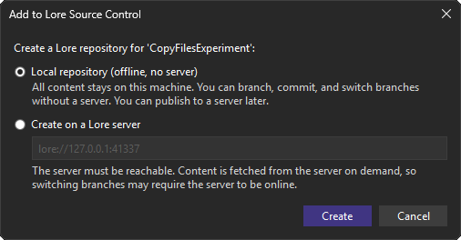
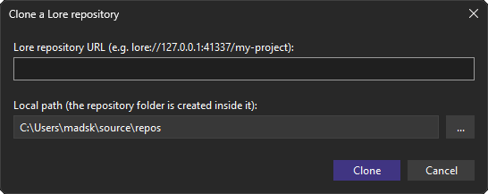
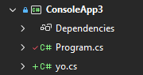
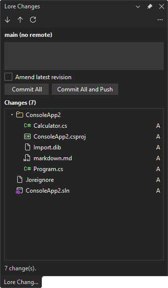

[marketplace]: <https://marketplace.visualstudio.com/items?itemName=MadsKristensen.LoreVS>
[vsixgallery]: <https://www.vsixgallery.com/extension/LoreVS.4beb5277-15de-4fff-bcaa-82af106d7233>
[repo]: <https://github.com/madskristensen/LoreVS>

# Lore for Visual Studio

[](https://github.com/madskristensen/LoreVS/actions/workflows/build.yaml)
[][vsixgallery]
[](https://github.com/sponsors/madskristensen)

Download this extension from the [Visual Studio Marketplace][marketplace]
or get the latest CI build from [Open VSIX Gallery][vsixgallery].

----------------------------------------------

Bring [Lore](https://github.com/EpicGames/lore) source control directly into
Visual Studio. Onboard a solution or folder, see file status at a glance, and
commit - all without leaving the IDE or dropping to a terminal.

## Add a solution to Lore

Open the solution or folder, then click the **Add to Source Control** button on
the Visual Studio status bar (bottom-right) and choose **Lore**. Choose **Local repository** (the default)
to create a fully offline repository where all content stays on your machine, so
you can branch, commit, and switch branches without a server. Choose **Create on
a Lore server** and enter a server URL (e.g. `lore://127.0.0.1:41337`) only when
you want to bind a remote so you can push. Lore binds the loaded projects to the
provider; the `.lore` folder records the binding so it is restored automatically
the next time you open the solution.



## Clone an existing repository

Right-click the solution node and choose **Lore > Clone Lore Repository...**.
Paste a repository URL (e.g. `lore://127.0.0.1:41337/my-project`) and pick a
local folder; Lore connects through the SDK, clones the working tree, and
records the remote in `.lore` so push and pull work immediately.
Clone and server-backed create do not require the server's optional HTTP health
endpoint or assume an HTTP port relative to its Lore port. Connection and
authentication errors are reported by the Lore operation itself.



## See status at a glance

Once a solution is controlled, Visual Studio shows Lore status glyphs next to
files in Solution Explorer. Saving a document refreshes its glyph automatically,
and you can force a refresh any time with the **Refresh** button in the Lore
Changes window.



Right-click a file under **Lore** for **Undo Changes** (revert edits to the
committed version), **Compare with Unmodified** (diff against the committed
version), and **Ignore and Untrack Item** (adds it to `.loreignore`).

## Review and commit in the Lore Changes window

Choose **Lore > Commit to Lore...** to open a dedicated panel, similar to the built-in Git
Changes window.



The window shows the current branch with incoming/outgoing
indicators and arranges every changed file in a folder tree back to the
repository root, each file showing a status badge (M, A, D, R, C) on the right.
Renamed or moved files show an **R** badge, and hovering it reveals the path the
file was moved from.
Renames performed in Solution Explorer are tracked automatically. Changes made
outside Visual Studio are detected through Visual Studio's shared file-change
service and automatically refresh the window and editor status glyphs.
From here you can:

- Pick exactly which files to include in the next commit. Every changed file
  has a checkbox (checked by default) and each folder has a tri-state checkbox
  that selects or clears all the files beneath it; the header checkbox toggles
  everything at once. Your selection is remembered across automatic refreshes
  while you compose the commit.
- Write a commit message and **Commit All**, or **Commit All and Push** in one
  step. When you exclude some files the buttons update to show how many are
  selected (for example **Commit 2** / **Commit 2 and Push**) and only those
  files are committed. Tick **Amend latest revision** to fold the selected
  changes into the previous revision instead.
  Partial commits preserve excluded working files and recorded renames. Resolve
  or abort an in-progress merge before making a partial commit, so its staged
  resolutions are not reset.
- Expand or collapse folders, and double-click a file (or right-click >
  **Open Diff**) to compare the working
  copy against the committed version in the native Visual Studio diff viewer.
- Right-click a file and choose **Discard Changes...** to reset it to the last
  committed state.
- Use the toolbar to **Pull** (sync the latest remote revisions), **Push**
  committed revisions, or **Refresh** the change list.

If Pull falls back to local history because no remote is configured or the remote
branch cannot be queried, the extension displays a warning and records it in the
Output window. Local synchronization does not mean remote changes were fetched.

## Lock non-mergeable files

In Solution Explorer, right-click one or more files and choose **Lore > Lock**
before editing binary assets. Choose **Lore > Unlock** when you are finished.
Files must belong to the same repository and already exist in the committed or
staged snapshot. Locking does not stage, commit, or change file contents.

The **Lore Changes** window offers the same commands on a changed file and in
its **Locks** list. The list shows all locks on the current branch, including
unchanged files, with the server-reported owner. Changed rows display the owner
alongside their normal M/A/D/R/C status; unchanged locked files are never added
to the commit selection. Lock/Unlock targets the right-clicked file, independent
of the checkboxes used for committing. The native context menu also supports
the Menu key and Shift+F10.

Locks are refreshed on workspace/branch changes, explicit **Refresh**, and after
Lock/Unlock. Document saves reuse the last lock result instead of requiring a
server round trip for every edit. Lock status
requires a reachable remote; failures are shown as **Lock status unavailable**,
not as an empty successful query. Lock/Unlock uses the existing sign-in flow
when the server requests authentication. Ownership comes from the authenticated
server session, not the commit-author identity setting. The extension does not
request force release or supply an alternate owner; server permissions still
govern whether a lock can be released. Locks are scoped to a branch.

## Manage branches

Choose **Lore > Manage Branches...** on the solution or folder, use the branch
management button on the Lore Changes toolbar, or open **View > Other Windows >
Manage Branches...**. The **Lore Branches** window provides:

- Branch information: identity, category, creator, creation timestamp, parent,
  branch point, ancestor stack, archived state, and separate local and remote
  revision tips.
- **Compare branches**: select explicit source (left) and target (right) branches
  to compare their committed snapshots. Double-click a file, press Enter, or use
  **Open selected file diff** for the native Visual Studio diff viewer. Renames
  preserve the original path, and added/deleted files use an empty side. The
  native three-way merge preview's base and potential conflict paths are shown
  separately from snapshot differences. Remote tips and uncached content may
  require a server connection. No merge or checkout is performed.
- **Protect...** and **Unprotect...**: confirmed native Lore protection changes.
  Server permissions apply when a remote is configured; otherwise the change
  affects local metadata. Lore's branch-info API does not expose protection state,
  so the window offers both explicit operations rather than guessing a toggle.
- **Archive...**: confirmed archive locally and on the configured remote. The
  current, default, and protected branches cannot be archived. No forced removal
  or layer/link cascade is requested. The native operation is not transactional:
  a remote failure can leave a partial archive, which is reported as a failure.
  Refresh branch information before retrying.
- **Reset branch to revision...**: enter a committed revision on the selected
  branch (or its branch point), then confirm the target and previous tip. Reset
  is local only and never pushes or rewrites the server branch. Resetting the
  current branch also updates its working files; resetting another branch leaves
  the current files alone. Save or close unsaved documents first, and commit or
  discard all working/staged changes and finish or abort any merge. If the tip
  changed since it was displayed, refresh and confirm again. The previous tip is
  recorded in the Lore Output window for recovery.

Use **Refresh branches** after changes made outside this window. Server operations
use the existing sign-in flow and surface errors rather than reporting empty or
successful results when the backend fails.

## Browse revision history

Choose **Lore > View History...** to open the **Lore History** tool window - a
read-only log of the repository bound to the open solution or folder. Cached
history works offline; missing older revisions in a fresh clone are fetched from
the remote as needed. Browsing history never changes your working tree.

The window loads the newest revisions first, a page at a time, so a repository
with thousands of revisions stays responsive. Each row shows the first line of
the commit message, the short revision hash, the author, and the local commit
time; hover a row to see the full message, revision number, branch, and date.
When more revisions are available, a **Load more** button appends the next page.

- Select a revision to load the files it changed (relative to its direct parent).
  File details are fetched only for the revision you select, not for the whole
  list.
- Ctrl+click two revisions to compare their complete snapshots, including
  nonadjacent revisions. The older revision is always the left side, regardless
  of selection order. Double-click a result to open the native Visual Studio
  diff viewer. Added and deleted files compare against an empty side; renamed
  files use their original path on the left. Historical read failures are
  reported rather than silently opening your working copy.
- Double-click a changed file to diff that revision against its direct parent in
  the native Visual Studio diff viewer. Added files open on their own, deleted
  files show their last content from the parent, and a root revision (which has
  no parent) opens the file as it was first committed. The diff is produced
  read-only and never touches your working tree.

The window follows the open workspace: switching solutions or folders re-resolves
the repository automatically. When the current solution or folder is not under
Lore source control, the window says so.

The log does not reload every time the window regains focus. It refreshes on its
own after a Lore operation performed in the extension changes history - a commit,
a pull, or a branch switch, create, or merge - and when the open workspace
changes. To reload it yourself at any time, click **Refresh** on the Lore History
toolbar.

## Sign in to a server

Authentication happens automatically, only when it is needed. When a clone,
push, pull, or server-backed create fails because the Lore server requires
sign-in (or a saved session has expired), Lore asks whether you want to sign in.
Confirm and your default browser opens to complete sign-in; when it finishes,
the original operation is retried. The session is stored by Lore, so later
operations against the same server do not prompt again. There is no separate
sign-in command - just run the operation you want, the same way Git prompts
through its credential manager.

The extension bundles the LoreVcs 0.10.0 SDK and its matching Windows native
runtime; updating the separately installed Lore CLI does not update this payload.
Lore 0.9 changed the credential store without migrating older sessions, so users
upgrading from the previous extension may need to sign in again. Permission
denials and connection failures are reported without repeatedly prompting for
sign-in; only Lore's `NotAuthenticated` status triggers the sign-in/retry flow.

## Work with branches

Click the branch button (showing the current branch name) on the Lore Changes
toolbar to open the branch picker. From there you can:

- Switch to any other local branch (the current branch is marked and disabled).
- Choose **New Branch...** to open the create-branch dialog. Enter a name, see
  the branch you are basing it on (Lore always branches from the current
  revision), and choose whether to check out the new branch. Leave **Checkout
  branch** unchecked to create the branch without leaving your current one.
- Choose **Merge Branch into Current...** and pick a branch to fold it into the
  branch you are on. When the merge has conflicts, Visual Studio's built-in 3-way
  merge tool opens for each conflicted file (current, incoming, and base). Resolve
  and accept each one and Lore commits the merge automatically; close the merge
  tool without accepting to abort and restore the working tree.

Switching and merging are offline-first: when the target branch's content is
already cached locally they complete without a network round trip. Lore's local
store is an LRU cache, so content can be evicted; if a switch or merge needs
content that is no longer cached, it is fetched from the Lore server. When that
content is missing and the server is unreachable, the operation reports a clear
message asking you to start (or reconnect to) your Lore server and try again.
Remote-only branches also retry online when their names are not yet cached.

## Settings

Configure everything under **Tools > Options > Lore**:

| Setting | Description |
| ------- | ----------- |
| Identity | Commit identity (e.g. `you@example.com`). |
| Push after commit | Automatically push every successful commit. |
| Server port (gRPC/QUIC) | gRPC/QUIC port used to build repository URLs. Default `41337`. |

## Run the server integration tests

The server functional tests run without opening Visual Studio. They start a
disposable Lore server bound only to loopback, with temporary storage and
automatically selected ports, then exercise the actual brokered client, named
pipe transport, worker, and native SDK. They verify server-backed create, clone,
commit, push, pull, revision hashes, and file contents in both directions. The
tests cover an HTTP endpoint on an independent port and HTTP disabled entirely,
uncached history and historical diffs, then stop the server and verify that a
connection timeout reports failure without requesting sign-in or altering files.
They also verify branch-scoped acquire/query/status/release across two working
copies, repeated acquisition, multiple files, rejected requests, and lock-query
failure when the server is stopped. The unauthenticated local server uses a
shared anonymous lock owner, so cross-user contention and unauthorized release
require an authenticated server and are not claimed by these tests.
Branch tests cover uncached remote comparisons, branch metadata, remote-only
switch/merge, protection and rejected archive from a second working copy,
unprotect/archive and fresh-clone verification, and a local reset that preserves
the remote tip. They also verify that an unavailable server cannot report a
successful protection change.

Build the solution first. Download and extract the Windows x64
[Lore server 0.10.1 release](https://github.com/EpicGames/lore/releases/tag/v0.10.1),
then run in PowerShell, substituting the path to the extracted executable:

```powershell
$env:LOREVS_TEST_SERVER_PATH = 'C:\tools\loreserver.exe'
dotnet test LoreVS.slnx --configuration Debug --no-build --no-restore --filter 'TestCategory=ServerIntegration'
```

No existing repositories or installed Lore executables are changed. The tests
stop their server and delete their temporary repositories afterward. Without
`LOREVS_TEST_SERVER_PATH`, these tests are skipped; an invalid configured path
fails the tests. CI downloads a checksum-pinned server and runs them with the
rest of the suite automatically. This local server has authentication disabled;
browser sign-in, credential migration, and authenticated permission checks still
require a separately configured authentication service.

## Get involved

Found a bug? Have an idea? Head to the [issue tracker][repo] - pull
requests are always welcome.
